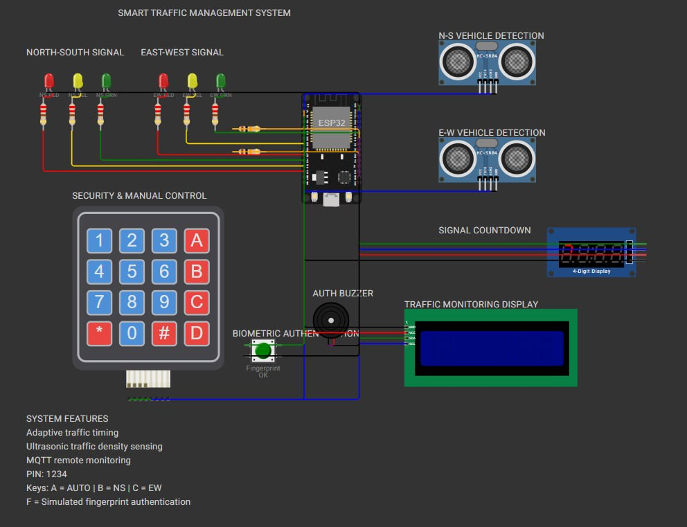
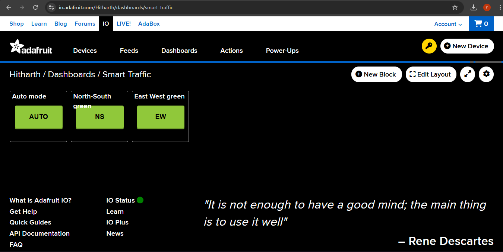
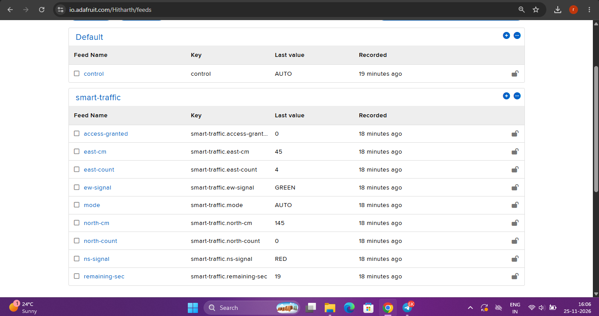
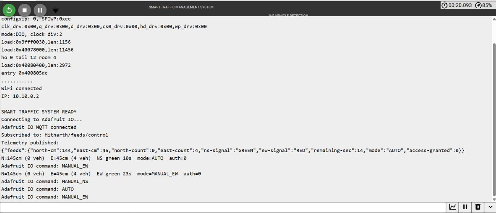
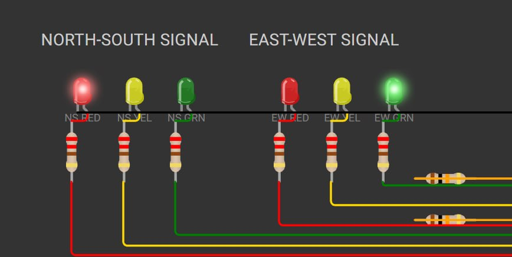

# Smart Traffic Light Control System

**Adaptive Traffic Management • ESP32/Wokwi • STM32 Reference Firmware • MQTT • Adafruit IO • Web Dashboard**

An IoT-enabled traffic-light prototype that estimates traffic demand on two intersecting approaches and adjusts green-signal duration accordingly. The project combines ultrasonic sensing, adaptive signal timing, authenticated manual modes, local displays, MQTT telemetry, and a browser-based monitoring dashboard.

<p align="center">

[](https://youtu.be/5HcRtLrCzyk)
[](https://github.com/hitarthrajora59/smart-traffic-light-control-system)

</p>

## 🎥 Project Demo

**[▶ Watch the Smart Traffic Light Control System Demo](https://youtu.be/5HcRtLrCzyk)**

## 🔗 Project Repository

**[View source code on GitHub](https://github.com/hitarthrajora59/smart-traffic-light-control-system/)**

---

## 📚 Table of Contents

- [1. Introduction](#1-introduction)
- [2. Project at a Glance](#2-project-at-a-glance)
- [3. System Architecture](#3-system-architecture)
- [4. Hardware Components](#4-hardware-components)
- [5. Traffic-Density Estimation](#5-traffic-density-estimation)
- [6. Adaptive Signal-Control Logic](#6-adaptive-signal-control-logic)
- [7. Authentication and Operating Modes](#7-authentication-and-operating-modes)
- [8. MQTT and Adafruit IO](#8-mqtt-and-adafruit-io)
- [9. Backend and Dashboard](#9-backend-and-dashboard)
- [10. Repository Structure](#10-repository-structure)
- [11. Setup and Deployment](#11-setup-and-deployment)
- [12. Firmware Reference](#12-firmware-reference)
- [13. Prototype Validation](#13-prototype-validation)
- [14. Limitations and Integration Notes](#14-limitations-and-integration-notes)
- [15. Project Gallery](#15-project-gallery)
- [16. Future Enhancements](#16-future-enhancements)
- [17. Disclaimer](#17-disclaimer)

---

# 1. Introduction

The **Smart Traffic Light Control System** is an embedded/IoT prototype designed to adapt traffic-signal timing using estimated vehicle demand on the North–South (NS) and East–West (EW) approaches.

Two HC-SR04 ultrasonic sensors measure the distance to nearby objects. The measured distance is mapped to an estimated density level, and the controller allocates a longer green interval to the direction with greater estimated demand.

The ESP32 simulation also provides:

- Red, yellow and green signal LEDs for both directions.
- A 16×2 I²C LCD for sensor distances, active direction, remaining time and operating mode.
- A TM1637 four-digit countdown display.
- Keypad PIN authentication and a button representing fingerprint authorization.
- `AUTO`, `MANUAL_NS` and `MANUAL_EW` operating modes.
- Wi-Fi and MQTT connectivity to Adafruit IO.
- A Node.js/Express backend with telemetry APIs and live Server-Sent Events (SSE).

### Objectives

- Estimate traffic demand from ultrasonic sensor readings.
- Dynamically adjust green-signal duration based on relative demand.
- Prevent conflicting green signals for the two approaches.
- Provide a yellow transition phase when changing direction.
- Support authenticated manual control and automatic operation.
- Publish telemetry and support remote mode commands.
- Display live traffic and signal information on a web dashboard.

---

# 2. Project at a Glance

| Area | Implementation |
|---|---|
| Simulation controller | ESP32 in Wokwi |
| Target reference controller | STM32F103C8 (Blue Pill) |
| Traffic sensing | 2 × HC-SR04 ultrasonic sensors |
| Signal outputs | 6 LEDs: red, yellow and green for NS/EW |
| Local display | 16×2 I²C LCD |
| Countdown display | TM1637 7-segment module |
| User input | 4×3 keypad and authentication pushbutton |
| Audio indication | Buzzer |
| Local configuration | ESP32 Preferences / NVS |
| Wireless connectivity | Wi-Fi |
| Cloud messaging | Adafruit IO MQTT |
| Backend | Node.js, Express, MQTT.js |
| Dashboard transport | Server-Sent Events (SSE) |
| Database scaffold | PostgreSQL schema / Render blueprint |
| Deployment scaffold | Render |

---

# 3. System Architecture


The system is divided into four layers:

1. **Sensing layer:** HC-SR04 sensors measure object distance on the two approaches.
2. **Embedded control layer:** The ESP32 estimates demand, selects a signal direction, manages timing, authentication and displays.
3. **Cloud communication layer:** MQTT publishes telemetry and receives remote commands through Adafruit IO.
4. **Application layer:** The Node.js backend receives telemetry and exposes it to the dashboard using HTTP APIs and SSE.

---

# 4. Hardware Components

## 4.1 ESP32

The ESP32 runs the Wokwi end-to-end simulation firmware. It reads the ultrasonic sensors, controls the traffic LEDs and displays, handles keypad/button input, stores the base green time in Preferences, and communicates over Wi-Fi/MQTT.

## 4.2 HC-SR04 Ultrasonic Sensors

Two ultrasonic sensors are used:

- **North sensor:** monitors the North–South approach.
- **East sensor:** monitors the East–West approach.

The controller triggers each sensor and measures the echo pulse duration.

\[
\text{Distance (cm)} = \frac{\text{Echo time in }\mu s}{58}
\]

A timeout/no-echo condition is represented as 400 cm in the supplied ESP32 sketch.

## 4.3 Traffic Signal LEDs

Each direction has three LEDs:

- **Red:** Stop
- **Yellow:** Transition / caution
- **Green:** Proceed

The control logic is designed so that both directions are not green simultaneously.

**Suggested image:** `images/traffic-signal-leds.jpg`

## 4.4 LCD and TM1637 Display

The I²C LCD displays North/East distance, current direction, remaining time and operating mode. The TM1637 module displays the countdown.

## 4.5 Keypad, Authentication Button and Buzzer

The keypad accepts a four-digit demonstration PIN (`1234`). After successful authentication, keys A, B and C select `AUTO`, `MANUAL_NS` and `MANUAL_EW` respectively.

The pushbutton represents a simulated fingerprint-success input; it is **not** a physical fingerprint sensor. The buzzer provides feedback for authentication events.

---

# 5. Traffic-Density Estimation

The ESP32 firmware maps measured distance to an estimated traffic-demand level using the following bands:

| Measured distance | Estimated count/level |
|---|---:|
| Less than 15 cm | 8 |
| 15 cm to less than 30 cm | 6 |
| 30 cm to less than 60 cm | 4 |
| 60 cm to less than 100 cm | 2 |
| 100 cm or more / no echo | 0 |

These values are **estimated density levels, not direct vehicle counts**. Results depend on sensor placement, object size, alignment and the simulation's distance settings.

---

# 6. Adaptive Signal-Control Logic

The base green duration is 15 seconds by default. The firmware adjusts the selected direction's green duration according to the difference between its estimated count and the opposite direction's count:

\[
T_g = \operatorname{constrain}\left(T_b + 2(C_s-C_o),\,8,\,30\right)
\]

Where:

- \(T_g\) = calculated green duration (seconds)
- \(T_b\) = base green duration
- \(C_s\) = estimated count for the selected direction
- \(C_o\) = estimated count for the opposite direction

The result is limited to a minimum of **8 seconds** and a maximum of **30 seconds**. A yellow phase of approximately 1.2 seconds is applied when switching directions.

The base green duration can be changed through the serial monitor:

- `+` increases the base duration by one second.
- `-` decreases the base duration by one second.

The permitted base duration is 8–30 seconds. ESP32 Preferences stores the value in non-volatile storage.

**Suggested image:** `images/adaptive-timing-demonstration.jpg`

---

# 7. Authentication and Operating Modes

## PIN Authentication

1. Enter the demonstration PIN `1234` on the keypad.
2. The buzzer indicates success or failure.
3. After successful authentication, select a mode using the keypad.

## Simulated Fingerprint Authorization

The authentication pushbutton grants access when pressed. This is only a button-based simulation of a fingerprint authorization event. No biometric template is captured or matched.

## Operating Modes

| Key / Command | Mode | Behaviour |
|---|---|---|
| A / `AUTO` | AUTO | Automatically alternates directions using adaptive timing |
| B / `MANUAL_NS` | MANUAL_NS | Selects North–South green |
| C / `MANUAL_EW` | MANUAL_EW | Selects East–West green |

Remote MQTT commands can also request `AUTO`, `MANUAL_NS` or `MANUAL_EW`, subject to the topic and message format configured in the firmware.

---

# 8. MQTT and Adafruit IO

The supplied Adafruit IO ESP32 sketch connects to:

| Setting | Configuration |
|---|---|
| MQTT host | `io.adafruit.com` |
| MQTT port in supplied sketch | `1883` |
| Telemetry group key | `smart-traffic` |
| Control feed key | `control` |
| Telemetry publish interval | 30 seconds |
| Sensor refresh interval | 1 second |

The group telemetry includes these feed keys:

- `north-cm`
- `east-cm`
- `north-count`
- `east-count`
- `ns-signal`
- `ew-signal`
- `remaining-sec`
- `mode`
- `access-granted`

Example group payload:

```json
{
  "feeds": {
    "north-cm": 42,
    "east-cm": 65,
    "north-count": 4,
    "east-count": 2,
    "ns-signal": "GREEN",
    "ew-signal": "RED",
    "remaining-sec": 18,
    "mode": "AUTO",
    "access-granted": 1
  }
}
```

> **Security:** Never publish Wi-Fi passwords or Adafruit IO keys in source code or public repositories. Any previously exposed credentials should be revoked/regenerated. Keep replacement values in a private configuration file excluded from Git.

For an internet-facing deployment, use MQTT over TLS and verify broker, authentication, topic and payload compatibility.

---

# 9. Backend and Dashboard

## 9.1 Node.js Backend

The `server/` directory contains an Express server and MQTT.js client. The backend is intended to:

- Connect to an MQTT broker using environment variables.
- Subscribe to a telemetry topic.
- Validate telemetry fields and signal states.
- Retain recent telemetry in memory.
- Expose REST endpoints for health, latest telemetry, history and statistics.
- Stream updates to browser clients using Server-Sent Events.
- Publish remote mode commands to a configured control topic.

## 9.2 Dashboard

The browser dashboard is served from `server/public/`. It displays current telemetry and uses the backend endpoints and SSE event stream to update the page.

## 9.3 API Endpoints

| Endpoint | Method | Purpose |
|---|---|---|
| `/health` | GET | Reports server and MQTT connection status |
| `/api/latest` | GET | Returns the latest telemetry |
| `/api/telemetry?limit=100` | GET | Returns recent telemetry samples |
| `/api/stats` | GET | Returns sample count and basic traffic statistics |
| `/events` | GET | Opens the live Server-Sent Events stream |
| `/api/control` | POST | Publishes a validated operating-mode command |

Example control request:

```json
{
  "mode": "MANUAL_NS"
}
```

## 9.4 Database Status

The repository includes `database/schema.sql` and a Render PostgreSQL resource definition. The current backend implementation uses an in-memory array for recent readings; PostgreSQL persistence should therefore be treated as a scaffold/future integration unless database operations have been implemented and tested.

---

# 10. Repository Structure

```text
smart-traffic-light-control-system/
├── README.md
├── .gitignore
├── render.yaml
├── database/
│   └── schema.sql
├── docs/
│   ├── Smart_Traffic_Light_Control_System_SRS.docx
│   └── Smart_Traffic_Light_Control_System_SRS.pdf
├── images/                         # Project photos/screenshots currently included
│   ├── project-overview.jpg
│   ├── wokwi-circuit-overview.png
│   ├── dashboard-overview.png
│   ├── dashboard-live-telemetry.png
│   ├── adaptive-timing-demonstration.jpg
│   └── traffic-signal-leds.jpg
│   └── project-overview.jpg
├── server/
│   ├── package.json
│   ├── package-lock.json
│   ├── server.js
│   └── public/
│       ├── app.js
│       ├── index.html
│       └── style.css
├── stm32-reference/
│   ├── main.cpp
│   └── platformio.ini
└── wokwi/
    ├── README.md
    ├── diagram.json
    ├── libraries.txt
    ├── sketch.ino
    └── sketch_adafruit_io_provided.ino
```

> The exact contents of the repository may evolve. Update this tree whenever files or folders are added, removed or renamed.

---

# 11. Setup and Deployment

## 11.1 Clone the Repository

```bash
git clone https://github.com/hitarthrajora59/smart-traffic-light-control-system.git
cd smart-traffic-light-control-system
```

## 11.2 Run the Dashboard Locally

Prerequisites:

- Node.js 20 LTS or newer
- npm

```bash
cd server
npm install
npm start
```

The default server port is `10000`. Open:

- Dashboard: `http://localhost:10000`
- Health check: `http://localhost:10000/health`

Configure MQTT environment variables before starting the backend. Example PowerShell configuration:

```powershell
$env:PORT = "10000"
$env:MQTT_URL = "mqtts://YOUR_MQTT_BROKER:8883"
$env:MQTT_USERNAME = "YOUR_MQTT_USERNAME"
$env:MQTT_PASSWORD = "YOUR_MQTT_PASSWORD"
$env:MQTT_TOPIC = "YOUR_TELEMETRY_TOPIC"
$env:MQTT_CONTROL_TOPIC = "YOUR_CONTROL_TOPIC"
npm start
```

These values are examples/placeholders. Do not commit credentials.

## 11.3 Run the Wokwi Simulation

1. Open the Wokwi project in the Wokwi editor.
2. Use `wokwi/diagram.json` and the corresponding ESP32 sketch.
3. Ensure the libraries in `wokwi/libraries.txt` are available.
4. Start the simulation and open the Serial Monitor.
5. Change the HC-SR04 distance values in the simulation to test traffic-density bands.
6. Enter `1234` on the keypad to authenticate.
7. Use A/B/C to select `AUTO` / `MANUAL_NS` / `MANUAL_EW`.
8. Observe the signal LEDs, LCD, countdown display and buzzer.

The original Wokwi sketch and the separately supplied Adafruit IO sketch are distinct firmware variants. Check the relevant wiring, credentials and backend configuration before selecting a firmware version.

## 11.4 Build the STM32 Reference Firmware

Install PlatformIO Core, then run:

```bash
cd stm32-reference
pio run
```

The reference targets an STM32F103C8 Blue Pill. Confirm pin mapping and electrical levels for the actual hardware before flashing.

## 11.5 Deploy Using Render

1. Push the project to GitHub.
2. In Render, create a new Blueprint and select the repository containing `render.yaml`.
3. Configure MQTT broker URL, username, password, telemetry topic and control topic as secure environment variables.
4. Deploy the web service.
5. Open the deployed `/health` endpoint and verify the MQTT connection.
6. Open the dashboard URL and confirm telemetry is arriving.

The supplied Render blueprint provisions PostgreSQL, but persistent telemetry storage requires the corresponding database integration to be implemented and tested.

---

# 12. Firmware Reference

The project code is organized into the following areas:

- **ESP32/Wokwi simulation:** `wokwi/sketch.ino`
- **Adafruit IO ESP32 firmware variant:** `wokwi/sketch_adafruit_io_provided.ino`
- **STM32F103C8 reference firmware:** `stm32-reference/main.cpp`
- **Backend and REST/SSE/MQTT logic:** `server/server.js`
- **Dashboard client:** `server/public/app.js`
- **Dashboard markup and styling:** `server/public/index.html`, `server/public/style.css`
- **Database table definition:** `database/schema.sql`

Illustrative density and adaptive-timing logic:

```cpp
int trafficCount(long cm) {
    if (cm < 15)  return 8;
    if (cm < 30)  return 6;
    if (cm < 60)  return 4;
    if (cm < 100) return 2;
    return 0;
}

int adaptiveDuration(bool northSouth) {
    int selected = northSouth ? northCount : eastCount;
    int other    = northSouth ? eastCount : northCount;
    return constrain(greenSeconds + (selected - other) * 2, 8, 30);
}
```

The complete source files are included in the repository; they are not duplicated in full here.

---

# 13. Prototype Validation

The following checks can be performed in simulation or on the assembled prototype:

| Test | Expected observation |
|---|---|
| Change North sensor distance | North estimated demand changes according to the defined bands |
| Change East sensor distance | East estimated demand changes according to the defined bands |
| Increase relative demand on one side | Adaptive green duration increases for the selected direction |
| Countdown reaches zero in AUTO | Controller changes direction after yellow transition |
| Enter correct PIN | Access is granted and buzzer gives success feedback |
| Enter incorrect PIN | Access is denied and buzzer gives failure feedback |
| Press authentication button | Simulated fingerprint-success event grants access |
| Select A/B/C after authentication | AUTO / MANUAL_NS / MANUAL_EW mode is selected |
| MQTT connection available | Firmware can publish telemetry and receive subscribed commands |
| Open dashboard | Health/API endpoints and live event stream can be checked |

Do not present these checks as completed test results unless they have actually been run and recorded. Sensor accuracy, network latency and end-to-end reliability have not been quantified in this README.

---

# 14. Limitations and Integration Notes

1. **Two firmware variants:** The original Wokwi sketch and the separately supplied Adafruit IO sketch are not identical. Select and maintain one canonical firmware version for the final demonstration.
2. **MQTT/backend payload compatibility:** The backend and firmware may use different broker defaults, topics or payload structures. Confirm the broker configuration, subscribed topic and payload decoder before claiming full end-to-end integration.
3. **Control topic and command shape:** Ensure the MQTT control topic and message format match what the firmware callback expects. The firmware callback may expect plain-text commands such as `AUTO`, `MANUAL_NS` and `MANUAL_EW`.
4. **TLS:** The supplied Adafruit IO sketch uses port 1883 with a non-TLS client. For internet deployment, configure a supported TLS port and TLS-capable client, and verify certificate handling.
5. **Database:** SQL schema and Render database resources are present, but persistent database operations must be implemented and tested.
6. **Authentication:** The keypad PIN and pushbutton fingerprint simulation are demonstration mechanisms, not secure access-control measures.
7. **STM32 target:** The STM32 firmware is reference logic and may require pin, timer, sensor and electrical-interface adaptation for final hardware.

---

# 15. Project Gallery

The gallery below contains the six project photos/screenshots currently included in the repository. Add more images later only when they are uploaded to the `images/` folder and the README references their exact filenames.

## 15.1 Complete Project Setup



## 15.2 Wokwi Circuit


## 15.3 Dashboard Overview



## 15.4 Live Telemetry



## 15.5 Adaptive Timing Demonstration



## 15.6 Traffic Signal LEDs



---

# 16. Future Enhancements

- Integrate calibrated vehicle-counting sensors or camera-based detection.
- Add sensor calibration and filtering to improve demand estimation.
- Add fault detection for disconnected or invalid sensors.
- Add a physical fingerprint module if biometric authentication is required.
- Implement PostgreSQL insertion, history retrieval and database health checks.
- Add secure MQTT/TLS support.
- Add event logs, historical charts and CSV export to the dashboard.
- Improve non-blocking timing so sensing, display updates and network operations remain responsive.
- Validate the system with a documented test plan and measured results.

---

# 17. Disclaimer

This project is an educational prototype intended to demonstrate embedded control, sensor interfacing, adaptive traffic-signal timing, MQTT communication and web-based monitoring. It is not a certified traffic-control product and has not been validated for deployment on public roads.

The estimated vehicle-demand levels are derived from ultrasonic distance bands and should not be treated as actual lane counts. The keypad and pushbutton authentication are simulations, not production security mechanisms.

**Do not use this prototype to control real public-road traffic or make safety-critical decisions.**

---

<div align="center">

### Smart Traffic Light Control System

**Electronics & Communication Engineering • Embedded Systems • IoT • MQTT • Cloud Dashboard**

[🎥 Demo Video](https://youtu.be/5HcRtLrCzyk) · [💻 GitHub Repository](https://github.com/hitarthrajora59/smart-traffic-light-control-system/)

</div>
