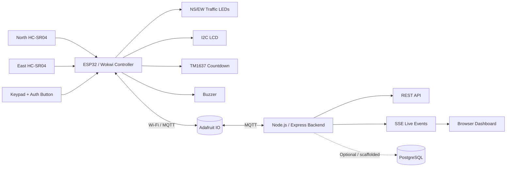

# Smart Traffic Light Control System
### Adaptive Traffic Management • ESP32/Wokwi • STM32 Reference Firmware • MQTT • Adafruit IO • Web Dashboard

An IoT-enabled traffic-light prototype that estimates vehicle density on two intersecting roads and adjusts green-signal duration accordingly. The system combines ultrasonic sensing, automatic and authenticated manual control, local displays, MQTT telemetry, and a browser-based monitoring dashboard.

## 🎥 Project Demo Video

[**Watch the Smart Traffic Light Control System demo**](PASTE_VIDEO_LINK_HERE)

> Replace `PASTE_VIDEO_LINK_HERE` with your YouTube, Google Drive, or other video URL when it is ready.

> **Project note:** The repository contains an ESP32-based Wokwi network simulation and a separate STM32F103C8 reference implementation. Wokwi's single-MCU simulation limitation is the reason these are maintained as separate firmware targets.

## 📚 Table of Contents

- [🎥 Project Demo Video](#-project-demo-video)
- [1. Introduction](#1-introduction)
  - [Objectives](#objectives)
- [2. Project at a Glance](#2-project-at-a-glance)
- [3. System Architecture](#3-system-architecture)
- [4. Hardware Components](#4-hardware-components)
  - [4.1 ESP32](#41-esp32)
  - [4.2 HC-SR04 Ultrasonic Sensors](#42-hc-sr04-ultrasonic-sensors)
  - [4.3 Traffic Signal LEDs](#43-traffic-signal-leds)
  - [4.4 LCD and TM1637 Display](#44-lcd-and-tm1637-display)
  - [4.5 Keypad, Authentication Button and Buzzer](#45-keypad-authentication-button-and-buzzer)
- [5. Traffic-Density Estimation](#5-traffic-density-estimation)
- [6. Adaptive Signal-Control Logic](#6-adaptive-signal-control-logic)
- [7. Authentication and Operating Modes](#7-authentication-and-operating-modes)
  - [PIN authentication](#pin-authentication)
  - [Simulated fingerprint authorization](#simulated-fingerprint-authorization)
  - [Operating modes](#operating-modes)
- [8. MQTT and Adafruit IO](#8-mqtt-and-adafruit-io)
- [9. Backend and Dashboard](#9-backend-and-dashboard)
  - [9.1 Node.js backend](#91-nodejs-backend)
  - [9.2 Dashboard](#92-dashboard)
  - [9.3 API endpoints](#93-api-endpoints)
  - [9.4 Database status](#94-database-status)
- [10. Repository Structure](#10-repository-structure)
- [11. Setup and Deployment](#11-setup-and-deployment)
  - [11.1 Clone the repository](#111-clone-the-repository)
  - [11.2 Run the dashboard locally](#112-run-the-dashboard-locally)
  - [11.3 Run the Wokwi simulation](#113-run-the-wokwi-simulation)
  - [11.4 Build the STM32 reference firmware](#114-build-the-stm32-reference-firmware)
  - [11.5 Deploy using Render](#115-deploy-using-render)
- [12. Firmware and Code Reference](#12-firmware-and-code-reference)
  - [Main embedded logic (illustrative excerpt)](#main-embedded-logic-illustrative-excerpt)
- [13. Prototype Validation](#13-prototype-validation)
- [14. Limitations and Integration Notes](#14-limitations-and-integration-notes)
- [15. Future Enhancements](#15-future-enhancements)
- [16. Disclaimer](#16-disclaimer)

## 1. Introduction

The Smart Traffic Light Control System is an embedded/IoT prototype designed to improve traffic-signal timing using estimated vehicle density on North-South (NS) and East-West (EW) approaches. Two HC-SR04 ultrasonic sensors measure the distance to nearby objects. The measured distance is mapped to an estimated traffic count, and the controller allocates a longer green interval to the direction with greater estimated demand.

The ESP32 Wokwi implementation also provides:
- Red, yellow and green signal LEDs for both directions.
- A 16×2 I2C LCD for sensor distances, active direction, remaining time and mode.
- A TM1637 four-digit display for the countdown.
- Keypad PIN authentication and a button representing fingerprint authorization.
- AUTO, MANUAL_NS and MANUAL_EW operating modes.
- Wi-Fi and MQTT connectivity to Adafruit IO.
- A Node.js/Express dashboard backend with telemetry APIs and live Server-Sent Events (SSE).

### Objectives
- Estimate traffic density from ultrasonic sensor readings.
- Dynamically adjust green-signal duration based on relative demand.
- Prevent conflicting green signals for the two directions.
- Provide a yellow transition phase when changing direction.
- Support authenticated manual control and automatic operation.
- Publish system telemetry and accept remote mode commands.
- Display live traffic and signal information on a web dashboard.

## 2. Project at a Glance

| Area | Implementation |
|---|---|
| Simulation controller | ESP32 in Wokwi |
| Target reference controller | STM32F103C8 (Blue Pill) |
| Traffic sensing | 2 × HC-SR04 ultrasonic sensors |
| Signal outputs | 6 LEDs: red, yellow and green for NS/EW |
| Local display | 16×2 I2C LCD |
| Countdown display | TM1637 7-segment module |
| User input | 4×3 keypad and authentication pushbutton |
| Audio indication | Buzzer |
| Local configuration | ESP32 Preferences / NVS |
| Wireless connectivity | Wi-Fi |
| Cloud messaging in supplied firmware | Adafruit IO MQTT |
| Backend | Node.js, Express, MQTT.js |
| Dashboard transport | Server-Sent Events (SSE) |
| Database scaffold | PostgreSQL schema and Render blueprint |
| Deployment scaffold | Render |

## 3. System Architecture



The system can be understood in four layers:

1. **Sensing layer:** HC-SR04 sensors measure the distance of objects in the two approaches.
2. **Embedded control layer:** ESP32 calculates estimated counts, selects the signal direction, manages timing, authentication and displays.
3. **Cloud communication layer:** MQTT publishes telemetry and receives remote control commands through Adafruit IO.
4. **Application layer:** Node.js receives and validates messages and exposes telemetry to the dashboard using HTTP APIs and SSE.

## 4. Hardware Components

### 4.1 ESP32
The ESP32 runs the Wokwi end-to-end simulation firmware. It reads both ultrasonic sensors, controls the traffic LEDs and displays, handles keypad/button input, stores the base green time in Preferences, and communicates over Wi-Fi/MQTT.

### 4.2 HC-SR04 Ultrasonic Sensors
Two sensors are used:
- North sensor: measures the North-South approach.
- East sensor: measures the East-West approach.

The controller triggers each sensor and measures the echo pulse duration. The approximate distance calculation is:

\[
\text{Distance (cm)} = \frac{\text{Echo time in }\mu s}{58}
\]

A timeout/no-echo condition is represented as 400 cm in the supplied ESP32 sketch.

### 4.3 Traffic Signal LEDs
Each direction has three LEDs:
- Red: stop
- Yellow: transition / caution
- Green: proceed

The control logic is designed so that both directions are not green simultaneously.

### 4.4 LCD and TM1637 Display
The I2C LCD displays North/East distance, current direction, remaining seconds and operating mode. The TM1637 module displays the countdown value.

### 4.5 Keypad, Authentication Button and Buzzer
The keypad accepts a four-digit PIN. The supplied sketch uses `1234` as the demonstration PIN. After successful authentication, keys A, B and C select AUTO, MANUAL_NS and MANUAL_EW respectively. The pushbutton represents a simulated fingerprint-success input; it is not a physical fingerprint sensor. The buzzer provides feedback for authentication events.

## 5. Traffic-Density Estimation

The ESP32 firmware maps the measured distance to an estimated vehicle count using the following bands:

| Measured distance | Estimated count |
|---|---:|
| Less than 15 cm | 8 |
| 15 cm to less than 30 cm | 6 |
| 30 cm to less than 60 cm | 4 |
| 60 cm to less than 100 cm | 2 |
| 100 cm or more / no echo | 0 |

These values are **estimated density levels**, not direct vehicle counts. The result depends on sensor placement, object size, alignment and the simulation's distance settings.

## 6. Adaptive Signal-Control Logic

The base green duration is 15 seconds by default. The firmware adjusts the selected direction's green duration according to the difference between its estimated count and the opposite direction's count:

\[
T_g = \operatorname{constrain}\left(T_b + 2(C_s-C_o),\,8,\,30\right)
\]

Where:
- \(T_g\) = calculated green duration in seconds
- \(T_b\) = base green duration
- \(C_s\) = estimated count for the selected direction
- \(C_o\) = estimated count for the opposite direction

The result is limited to a minimum of 8 seconds and a maximum of 30 seconds. A yellow phase of approximately 1.2 seconds is applied when switching directions.

The base green duration can be changed through the serial monitor:
- `+` increases the base duration by one second.
- `-` decreases the base duration by one second.

The permitted base duration is 8–30 seconds. ESP32 Preferences stores the value in non-volatile storage so it can persist across restarts.

## 7. Authentication and Operating Modes

### PIN authentication
1. Enter the four-digit demonstration PIN `1234` on the keypad.
2. The buzzer indicates success or failure.
3. After successful authentication, select a mode using the keypad.

### Simulated fingerprint authorization
The authentication pushbutton grants access when pressed. This is only a button-based simulation of a fingerprint authorization event. No biometric template is captured or matched.

### Operating modes

| Key / Command | Mode | Behaviour |
|---|---|---|
| A / `AUTO` | AUTO | Automatically alternates directions using the adaptive timer |
| B / `MANUAL_NS` | MANUAL_NS | Selects North-South green |
| C / `MANUAL_EW` | MANUAL_EW | Selects East-West green |

Remote MQTT commands can also request `AUTO`, `MANUAL_NS` or `MANUAL_EW`, subject to the topic and message format configured in the firmware.

## 8. MQTT and Adafruit IO

The supplied Adafruit IO ESP32 sketch connects to:
- MQTT host: `io.adafruit.com`
- MQTT port in the pasted sketch: `1883`
- Telemetry group key: `smart-traffic`
- Control feed key: `control`
- Telemetry publish interval: 30 seconds
- Sensor refresh interval: 1 second

The sketch constructs the group topic and control topic using the configured Adafruit IO username. Group telemetry includes the following feed keys:
- `north-cm`
- `east-cm`
- `north-count`
- `east-count`
- `ns-signal`
- `ew-signal`
- `remaining-sec`
- `mode`
- `access-granted`

A group publish uses the Adafruit IO group JSON format:

```json
{
  "feeds": {
    "north-cm": 42,
    "east-cm": 65,
    "north-count": 4,
    "east-count": 2,
    "ns-signal": "GREEN",
    "ew-signal": "RED",
    "remaining-sec": 18,
    "mode": "AUTO",
    "access-granted": 1
  }
}
```

**Security:** Do not publish Wi-Fi passwords or Adafruit IO keys in source code or public repositories. The pasted firmware contained credentials. Those values have intentionally not been copied into this README. Revoke/regenerate the exposed Adafruit IO key and change the exposed Wi-Fi password before using the project again. Put replacement values in a private, ignored configuration file or secure environment/configuration mechanism.

For an internet-facing deployment, prefer MQTT over TLS on the broker's supported TLS port and configure the firmware and backend with matching broker, authentication, feed/group and payload settings. Confirm the current Adafruit IO account limits and MQTT settings in the Adafruit IO account documentation before deployment.

## 9. Backend and Dashboard

### 9.1 Node.js backend
The `server/` directory contains an Express server and MQTT.js client. The checked-in server currently:
- Connects to an MQTT broker using environment variables.
- Subscribes to a telemetry topic.
- Validates telemetry fields and signal states.
- Retains recent telemetry in memory (up to 100 entries).
- Exposes REST endpoints for health, latest telemetry, history and statistics.
- Streams updates to browser clients using Server-Sent Events.
- Publishes remote mode commands to a configured control topic.

### 9.2 Dashboard
The browser dashboard is served from `server/public/`. It displays current telemetry and uses the backend endpoints and SSE event stream to update the page.

### 9.3 API endpoints

| Endpoint | Method | Purpose |
|---|---|---|
| `/health` | GET | Reports server and MQTT connection status |
| `/api/latest` | GET | Returns the latest received telemetry |
| `/api/telemetry?limit=100` | GET | Returns recent telemetry samples |
| `/api/stats` | GET | Returns sample count and basic traffic statistics |
| `/events` | GET | Opens the live Server-Sent Events stream |
| `/api/control` | POST | Publishes a validated operating-mode command |

Example control request:

```json
{
  "mode": "MANUAL_NS"
}
```

### 9.4 Database status
The repository includes `database/schema.sql` and a Render PostgreSQL resource definition. However, the current `server/server.js` implementation inspected for this README stores recent readings in an in-memory array and does not currently perform PostgreSQL insert/select operations. Therefore, database persistence should be treated as a scaffold/future integration until database operations are implemented and tested.

## 10. Repository Structure

```text
smart-traffic-light-control-system/
├── README.md
├── .gitignore
├── render.yaml
├── database/
│   └── schema.sql
├── docs/
│   ├── Smart_Traffic_Light_Control_System_SRS.docx
│   └── Smart_Traffic_Light_Control_System_SRS.pdf
├── server/
│   ├── package.json
│   ├── package-lock.json
│   ├── server.js
│   └── public/
│       ├── app.js
│       ├── index.html
│       └── style.css
├── stm32-reference/
│   ├── main.cpp
│   └── platformio.ini
└── wokwi/
    ├── README.md
    ├── diagram.json
    ├── libraries.txt
    ├── sketch.ino
    └── sketch_adafruit_io_provided.ino
```

`sketch_adafruit_io_provided.ino` contains the Adafruit IO ESP32 code supplied with the project materials. `sketch.ino` is the original Wokwi sketch from the ZIP. Review the integration notes in Section 14 before selecting which sketch to run.

## 11. Setup and Deployment

### 11.1 Clone the repository

```bash
git clone https://github.com/hitarthrajora59/smart-traffic-light-control-system.git
cd smart-traffic-light-control-system
```

### 11.2 Run the dashboard locally

Prerequisites:
- Node.js 20 LTS or newer
- npm

```bash
cd server
npm install
npm start
```

The default server port is `10000`. Open:
- Dashboard: `http://localhost:10000`
- Health check: `http://localhost:10000/health`

Configure the MQTT environment variables before starting the backend. Example PowerShell configuration:

```powershell
$env:PORT = "10000"
$env:MQTT_URL = "mqtts://YOUR_MQTT_BROKER:8883"
$env:MQTT_USERNAME = "YOUR_MQTT_USERNAME"
$env:MQTT_PASSWORD = "YOUR_MQTT_PASSWORD"
$env:MQTT_TOPIC = "YOUR_TELEMETRY_TOPIC"
$env:MQTT_CONTROL_TOPIC = "YOUR_CONTROL_TOPIC"
npm start
```

The values above are examples/placeholders. Do not commit credentials.

### 11.3 Run the Wokwi simulation

1. Open the Wokwi project in the Wokwi editor.
2. Use `wokwi/diagram.json` and the corresponding ESP32 sketch.
3. Ensure the libraries in `wokwi/libraries.txt` are available.
4. Start the simulation and open the Serial Monitor.
5. Change the HC-SR04 distance values in the simulation to test traffic-density bands.
6. Enter `1234` on the keypad to authenticate.
7. Use A/B/C to select AUTO / MANUAL_NS / MANUAL_EW.
8. Observe the signal LEDs, LCD, countdown display and buzzer.

The original Wokwi sketch in the ZIP uses its original MQTT configuration. The Adafruit IO sketch supplied separately is a distinct firmware variant and requires its own pin diagram, credentials and matching backend configuration.

### 11.4 Build the STM32 reference firmware

Install PlatformIO Core, then run:

```bash
cd stm32-reference
pio run
```

The reference targets an STM32F103C8 Blue Pill. Confirm the pin mapping and electrical levels for the actual hardware before flashing.

### 11.5 Deploy using Render

1. Push the project to GitHub.
2. In Render, create a new Blueprint and select the repository containing `render.yaml`.
3. Configure the MQTT broker URL, username, password, telemetry topic and control topic as secure environment variables.
4. Deploy the web service.
5. Open the deployed `/health` endpoint and verify the MQTT connection.
6. Open the dashboard URL and confirm telemetry is arriving.

The supplied Render blueprint provisions a PostgreSQL database, but the current backend requires additional database integration before telemetry is persistently written to it.

## 12. Firmware and Code Reference

The project code is included in the repository:
- **ESP32/Wokwi simulation:** `wokwi/sketch.ino`
- **Adafruit IO ESP32 firmware supplied separately:** `wokwi/sketch_adafruit_io_provided.ino`
- **STM32F103C8 reference firmware:** `stm32-reference/main.cpp`
- **Backend and REST/SSE/MQTT logic:** `server/server.js`
- **Dashboard client:** `server/public/app.js`
- **Dashboard markup and styling:** `server/public/index.html`, `server/public/style.css`
- **Database table definition:** `database/schema.sql`

### Main embedded logic (illustrative excerpt)

```cpp
int trafficCount(long cm) {
    if (cm < 15)  return 8;
    if (cm < 30)  return 6;
    if (cm < 60)  return 4;
    if (cm < 100) return 2;
    return 0;
}

int adaptiveDuration(bool northSouth) {
    int selected = northSouth ? northCount : eastCount;
    int other    = northSouth ? eastCount : northCount;
    return constrain(greenSeconds + (selected - other) * 2, 8, 30);
}
```

The complete source files listed above are included alongside this README; they are not duplicated in full inside this document to keep the README maintainable.

## 13. Prototype Validation

The following checks can be performed in simulation or on the assembled prototype:

| Test | Expected observation |
|---|---|
| Change North sensor distance | North estimated count changes according to the defined bands |
| Change East sensor distance | East estimated count changes according to the defined bands |
| Increase relative demand on one side | Adaptive green duration increases for the selected direction |
| Countdown reaches zero in AUTO | Controller changes direction after yellow transition |
| Enter correct PIN | Access is granted and buzzer gives success feedback |
| Enter incorrect PIN | Access is denied and buzzer gives failure feedback |
| Press authentication button | Simulated fingerprint-success event grants access |
| Select A/B/C after authentication | AUTO / MANUAL_NS / MANUAL_EW mode is selected |
| MQTT connection available | Firmware can publish telemetry and receive subscribed commands |
| Open dashboard | Health/API endpoints and live event stream can be checked |

Do not describe these checks as completed test results unless they have actually been run and recorded. Sensor accuracy, network latency and end-to-end reliability have not been quantified in this README.

## 14. Limitations and Integration Notes

1. **Two firmware variants:** The original ZIP's `wokwi/sketch.ino` and the separately supplied Adafruit IO sketch are not identical. Select and maintain one canonical firmware version for the final demonstration.
2. **MQTT mismatch in the supplied repository:** The checked-in backend still contains EMQX-oriented defaults and expects a per-device telemetry JSON object with fields such as `device_id`, `north_cm`, `ns_signal`, `mode` and `access_granted`. The supplied Adafruit IO firmware publishes a group payload shaped as `{"feeds":{...}}`. These formats are not directly compatible. Update the backend broker configuration, subscribe topic and payload decoder before claiming full Adafruit IO-to-dashboard integration.
3. **Control topic and command shape:** Ensure the Adafruit IO control feed topic and message format match what the firmware callback expects. The supplied firmware callback reads plain text commands such as `AUTO`, `MANUAL_NS` and `MANUAL_EW`.
4. **TLS:** The supplied Adafruit IO sketch uses port 1883 with `WiFiClient`, which is not TLS. For production/internet deployment, configure the supported TLS port and a TLS-capable client, and verify certificate handling.
5. **Database:** The SQL schema and Render database resource are present, but database read/write logic is not implemented in the inspected backend.
6. **Authentication:** The keypad PIN and pushbutton fingerprint simulation are demonstration mechanisms, not secure access-control measures.
7. **STM32 target:** The STM32 firmware is reference logic and may require pin, timer, sensor and electrical-interface adaptation for the final hardware.

## 15. Future Enhancements

- Migrate the backend completely to Adafruit IO MQTT and decode group-feed payloads.
- Add secure MQTT/TLS support in the ESP32 firmware.
- Move Wi-Fi and Adafruit IO credentials into a private configuration header excluded from Git.
- Implement PostgreSQL insertion, history retrieval and database health checks.
- Add sensor calibration and filtering to improve density estimation.
- Add a physical fingerprint module if biometric authentication is required.
- Add fault detection for disconnected or invalid sensors.
- Improve non-blocking timing so sensing, display updates and network operations remain responsive.
- Add event logs, historical charts and CSV export to the dashboard.
- Validate the system with a documented test plan and measured results.

## 16. Disclaimer

This project is an educational prototype intended to demonstrate embedded control, sensor interfacing, adaptive traffic-signal timing, MQTT communication and web-based monitoring. It is not a certified traffic-control product and has not been validated for deployment on public roads. The estimated vehicle counts are derived from ultrasonic distance bands and should not be treated as actual lane counts. The keypad and pushbutton authentication are simulations, not production security mechanisms.

**Do not use this prototype to control real public-road traffic or make safety-critical decisions.**

---
**Smart Traffic Light Control System**  
Electronics & Communication Engineering • Embedded Systems • IoT • MQTT • Cloud Dashboard
